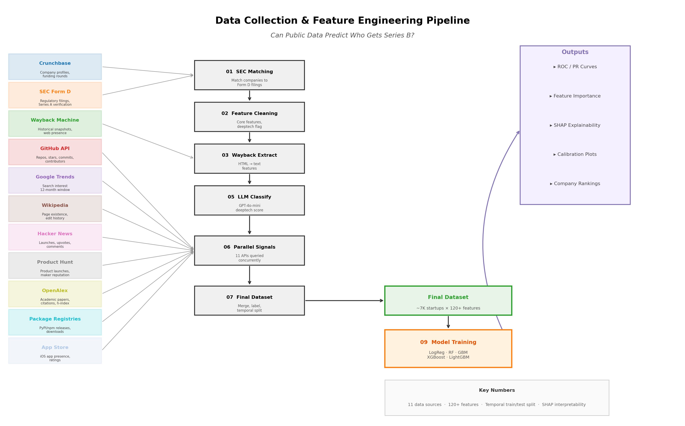
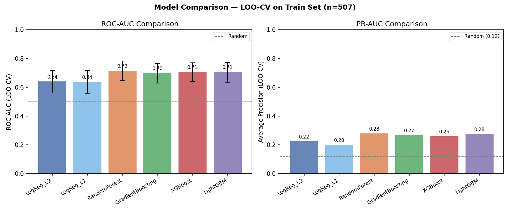
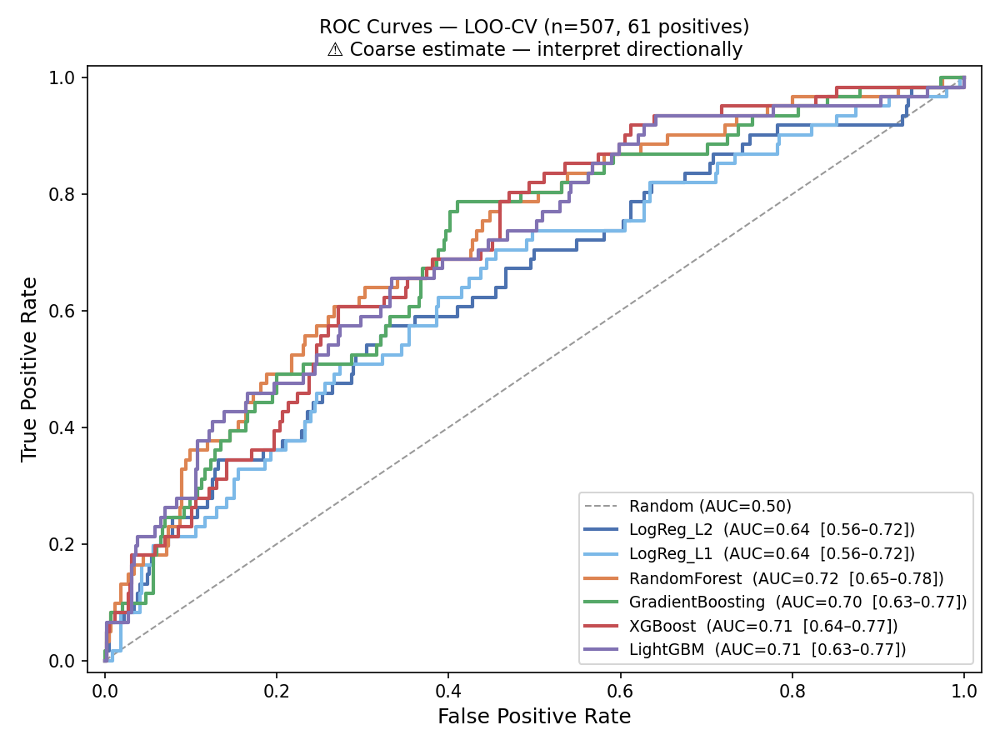
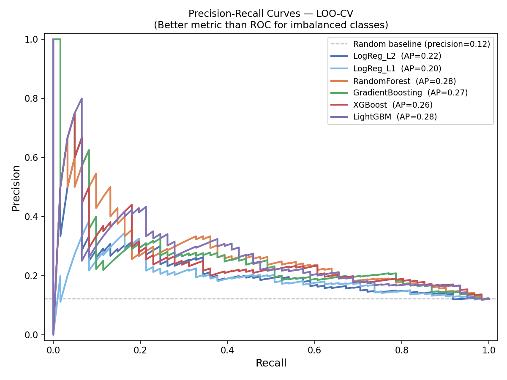
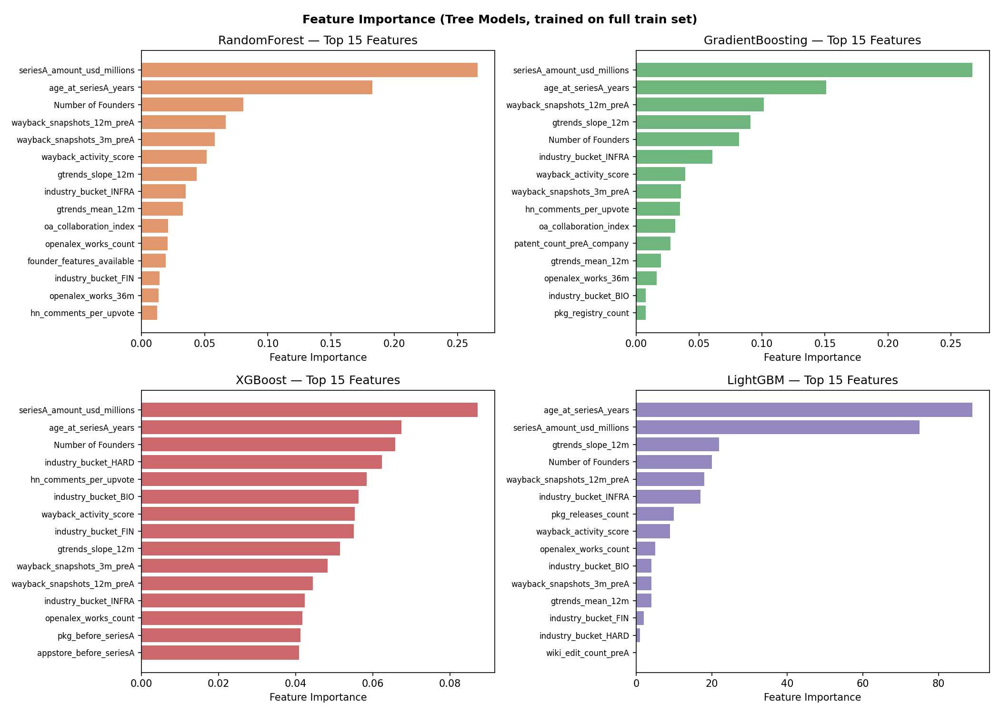
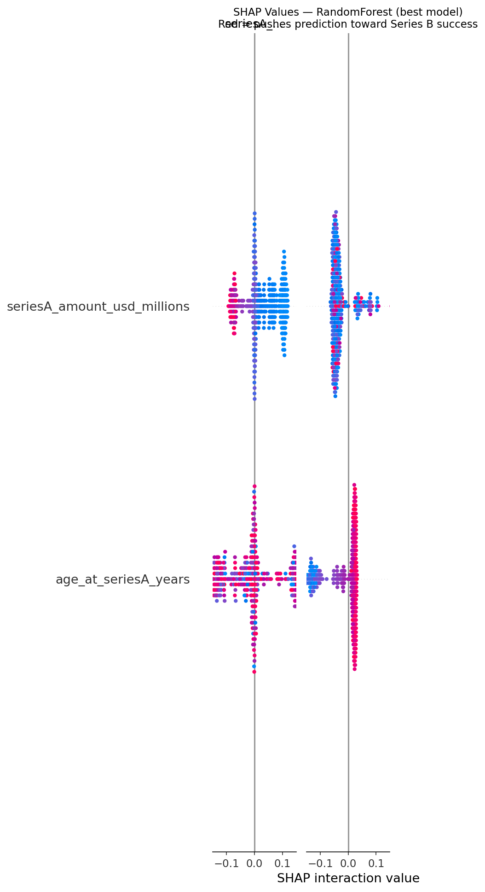
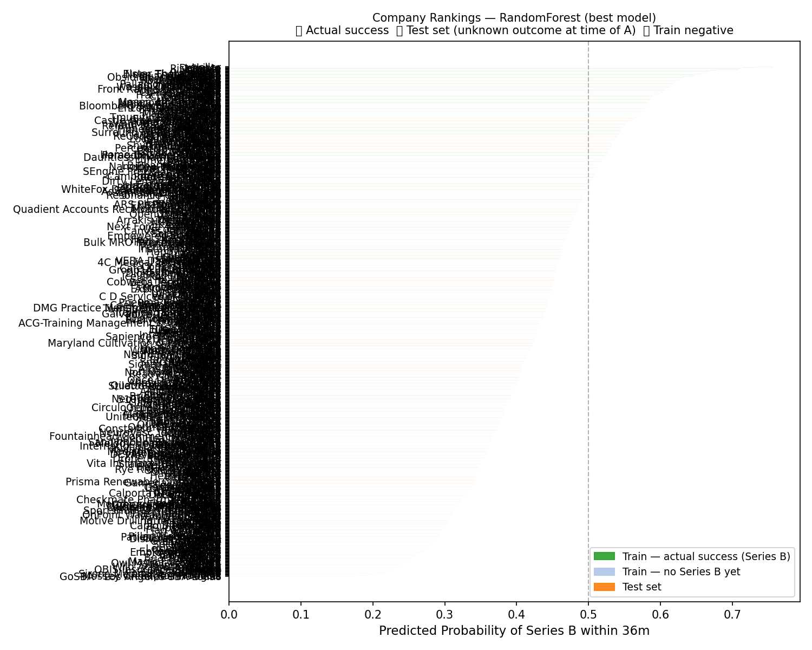
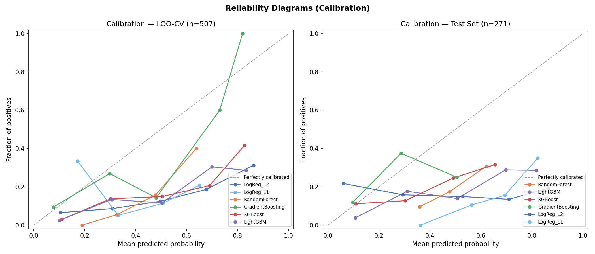

# Predicting Startup Success from Pre-Series A Public Signals

> **Arthur Schoen** — MIT (Master of Science in Data Science) / HEC Paris
> Master's Thesis — Can publicly available signals predict which deeptech startups will raise Series B?

[](https://www.python.org/downloads/)
[](https://opensource.org/licenses/MIT)

---

## Problem Statement

Venture capital deal sourcing relies heavily on qualitative judgment. VCs spend enormous time evaluating startups, yet most signals — founder quality, traction, IP strength — are assessed subjectively.

**This project asks:** can we predict whether a deeptech startup will raise Series B+ funding within 36 months of its Series A, using only publicly available pre-Series A data?

**Target variable:** `SeriesB_within_36m` — binary classification (1 = raised Series B, C, D, Late Stage, or IPO within 36 months).

---

## Architecture

```
┌─────────────────────────────────────────────────────────────────────────┐
│                     DATA COLLECTION (13+ APIs)                          │
│                                                                         │
│  Crunchbase ─── SEC Form D ─── Wayback Machine ─── GitHub API           │
│  Google Trends ── Wikipedia ── OpenAlex ── Hacker News ── Product Hunt  │
│  EPO Patents ── PyPI/npm/crates ── Clinical Trials ── NIH Grants        │
│  App Store (iOS/Android)                                                │
└────────────────────────────────┬────────────────────────────────────────┘
                                 │
                                 ▼
┌─────────────────────────────────────────────────────────────────────────┐
│                    FEATURE ENGINEERING (~120 features)                   │
│                                                                         │
│  Step 01: SEC Form D Matching (Company → CIK, Series A date/amount)     │
│  Step 02: Core Feature Cleaning (deeptech flag, industry bucket)        │
│  Step 05: LLM Classification (GPT-4o-mini → deeptech score, sector)     │
│  Step 06: Parallel Signal Orchestration ─────────────────────┐          │
│     ├─ Google Trends (slope, volatility, breakout detection)  │          │
│     ├─ Wikipedia (existed at Series A? edit diversity)        │          │
│     ├─ GitHub (commits pre-A, contributor velocity)     12 STEPS        │
│     ├─ Packages (PyPI/npm release cadence)              CONCURRENT      │
│     ├─ OpenAlex (papers, citations, collaboration)            │          │
│     ├─ Hacker News / Product Hunt (launch signals)            │          │
│     ├─ Wayback + LLM (team maturity, web sophistication)     │          │
│     ├─ EPO Patents (IP portfolio pre-A)                       │          │
│     └─ App Store, Clinical Trials, NIH Grants                 │          │
│  ─────────────────────────────────────────────────────────────┘          │
│  Step 07: Anti-Leakage Filtering + Temporal Train/Test Split            │
└────────────────────────────────┬────────────────────────────────────────┘
                                 │
                                 ▼
┌─────────────────────────────────────────────────────────────────────────┐
│                      MODEL TRAINING & EVALUATION                        │
│                                                                         │
│  6 Models Compared:                                                     │
│    Logistic Regression (L1, L2) · Random Forest · Gradient Boosting     │
│    XGBoost · LightGBM                                                   │
│                                                                         │
│  Evaluation: Leave-One-Out CV (n=19) + Bootstrap 95% CI                 │
│  Metrics: ROC-AUC, PR-AUC (primary), Precision@K, SHAP explainability  │
└─────────────────────────────────────────────────────────────────────────┘
```

### Pipeline Diagram



---

## Data Sources (13+ APIs)

| Source | Signal Type | Pre-Series A Filtering |
|--------|------------|----------------------|
| **Crunchbase** | Company profiles, funding rounds | Founding date, industry, founders |
| **SEC Form D** | Series A date/amount verification | Equity filing timestamps |
| **Google Trends** | Search interest (slope, volatility, breakout) | 12-month window before Series A |
| **Wikipedia** | Notability (page existence, edit history) | Historical revision API at Series A date |
| **GitHub** | Developer activity (commits, contributors) | Only commits in 3/6/12m windows pre-A |
| **OpenAlex** | Academic footprint (papers, citations) | Works published before Series A only |
| **Hacker News** | Community traction (Show HN launches) | Posts dated before Series A |
| **Product Hunt** | Product launches, upvotes | Launch date filtering |
| **EPO Patents** | Intellectual property portfolio | Filing dates before Series A |
| **PyPI/npm/crates** | Open-source release cadence | First release date pre-A |
| **Wayback Machine** | Archived web presence + LLM analysis | Historical snapshots only |
| **App Store** | iOS/Android presence | Availability check pre-A |
| **Clinical Trials / NIH** | Biotech/research validation | Trial registration dates |

---

## Key Design Decisions

### Anti-Leakage Architecture
Every feature uses only **pre-Series A data**. This is enforced at the API level (timestamp filtering) and again at the feature selection level (leakage-risk columns are excluded). This includes:
- Wikipedia uses the **historical revision API** to get page state at Series A date, not the current page
- GitHub features use only commits in the 3/6/12-month windows before Series A
- Current-day metrics (stars, forks, downloads, citations) are all excluded

### LLM as Feature Extractor (not as the model)
GPT-4o-mini is used in two places as a **structured feature extractor**:
1. **Deeptech classification** — scores companies 0-10 on deeptech intensity, replacing brittle rule-based scoring
2. **Web presence analysis** — extracts team maturity, web sophistication, and founder signals from archived Wayback Machine HTML

### Handling Extreme Class Imbalance (2/19 positives)
- Class weight balancing (`balanced` / `scale_pos_weight=8.5`)
- PR-AUC as primary metric (more informative than ROC-AUC at 10.5% positive rate)
- LOO-CV (the only valid evaluation strategy at n=19)
- Bootstrap 95% CI (1000 resamples) to quantify uncertainty

### Parallel Signal Orchestration
All 12 signal collectors run concurrently via ThreadPoolExecutor, reducing execution from ~17 min to ~5 min (3.4x speedup).

---

## Results

### Model Comparison (LOO-CV)



### ROC & Precision-Recall Curves

<p float="left">
  
  
</p>

### Feature Importance & SHAP Explainability

<p float="left">
  
  
</p>

### Company Probability Rankings



### Calibration



---

## How to Extend / Scale

This pipeline is designed for **horizontal scaling**. With access to full Crunchbase data (~50K+ companies), the same architecture produces statistically robust results:

| Current State | Scaled State |
|--------------|-------------|
| 19 train samples | 5,000+ train samples |
| 2 positives (10.5%) | ~500+ positives |
| LOO-CV only | Proper K-fold + held-out test |
| Bootstrap CI overlap | Statistically significant comparisons |

### To extend with new data sources:
1. Create a new signal collector (e.g., `06n__new_source.py`)
2. It reads `PIPELINE_BASE_CSV` and writes `{RUN_ID}_XX_newsource__signals.csv`
3. Add it to `SIGNAL_STEPS` in `data_pipeline.py`
4. Add feature names to `FEATURE_OPTIONAL` in `feature_engineering.py`

### To add new models:
Add to the `get_models()` function in `model_training.py` and `MODEL_COLORS` dict.

---

## Project Structure

```
startup-success-prediction/
├── data_pipeline.py          # Parallel signal orchestration (13+ APIs)
├── feature_engineering.py    # Anti-leakage feature assembly + temporal split
├── model_training.py         # 6-model comparison with LOO-CV
├── evaluation.py             # All visualization plots (ROC, SHAP, etc.)
├── utils/
│   └── concurrent_runner.py  # Checkpoint/resume concurrent API processing
├── figures/                  # Generated evaluation plots
│   ├── 01_roc_curves.png
│   ├── 02_pr_curves.png
│   ├── 03_auc_comparison.png
│   ├── 04_feature_importance.png
│   ├── 05_shap_beeswarm.png
│   ├── 06_probability_ranking.png
│   ├── 08_calibration.png
│   └── 09_pipeline_diagram.png
├── requirements.txt
└── README.md
```

---

## Tech Stack

| Category | Tools |
|----------|-------|
| **ML Frameworks** | scikit-learn, XGBoost, LightGBM |
| **Explainability** | SHAP |
| **LLM Integration** | OpenAI GPT-4o-mini (feature extraction) |
| **Data Sources** | 13+ APIs (Crunchbase, SEC EDGAR, Wayback, GitHub, Google Trends, Wikipedia, OpenAlex, EPO, etc.) |
| **Concurrency** | ThreadPoolExecutor with checkpoint/resume |
| **Visualization** | matplotlib |

---

## Limitations & Honest Assessment

| Limitation | Mitigation |
|-----------|-----------|
| Tiny dataset (n=19 train) | LOO-CV + bootstrap CI; results interpreted directionally |
| Severe imbalance (10.5%) | Class weight balancing, PR-AUC as primary metric |
| No test-set positives | Probability rankings shown; full evaluation requires more data |
| Features >> samples | max_depth=2-3, strong regularization, non-zero threshold filter |
| LLM feature subjectivity | Fixed model version, structured prompts, deterministic parameters |

---

## License

MIT License

---

> **Acknowledgments**
> This work was completed as part of the Master of Science in Data Science at **MIT** and the MSc program at **HEC Paris**. Special thanks to the thesis advisors and the open-source community behind the APIs and tools used in this project.
